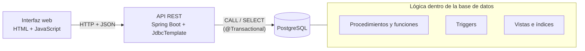
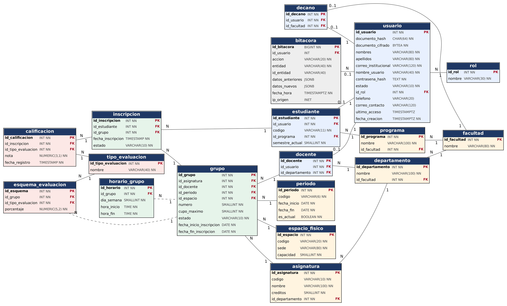

# SGA Reformado · Sistema de Gestión Académica


API REST y base de datos relacional para la gestión académica de la Universidad Distrital Francisco José de Caldas: grupos, inscripciones y calificaciones, con las reglas de negocio aplicadas dentro de la propia base de datos.

> Proyecto final de **Bases de Datos Avanzadas** · Ingeniería de Sistemas · Universidad Distrital Francisco José de Caldas · Docente: René Alejandro Lobo Quintero

## Contenido

1. [Descripción del sistema](#descripción-del-sistema)
2. [Requerimientos funcionales](#requerimientos-funcionales)
3. [Arquitectura](#arquitectura)
4. [Diagrama ER](#diagrama-er)
5. [Lógica en la base de datos](#lógica-en-la-base-de-datos)
6. [Instalación y configuración](#instalación-y-configuración)
7. [Endpoints principales](#endpoints-principales)
8. [Caso de uso principal: inscripción](#caso-de-uso-principal-inscripción)
9. [Estructura del repositorio](#estructura-del-repositorio)
10. [Integrantes del grupo](#integrantes-del-grupo)

## Descripción del sistema

Hoy la comunidad académica de la Universidad Distrital (estudiantes, docentes, decanos y personal administrativo) gestiona inscripciones, horarios y notas en el sistema Cóndor, que se queda corto en rendimiento y concurrencia cuando miles de personas se inscriben al tiempo. El SGA reformado rediseña esa base de datos en PostgreSQL y la expone mediante una API REST con una interfaz web.

Lo que lo distingue es que **la base de datos se defiende sola**: cupos, traslapes de horario, estados de los grupos y auditoría se validan con restricciones, procedimientos almacenados y triggers, de modo que ninguna petición (ni la API, ni pgAdmin) puede dejar los datos en un estado inconsistente.

| Rol | Qué hace en el sistema |
|---|---|
| Estudiante | Se inscribe y retira de grupos, consulta su horario y sus notas definitivas |
| Docente | Consulta sus grupos, registra y corrige calificaciones, define el esquema de evaluación |
| Decano | Crea grupos y consulta reportes de rendimiento de su facultad |
| Administrador | Gestiona usuarios y catálogos, consulta la bitácora de auditoría |

## Requerimientos funcionales

Funcionalidades implementadas:

| # | Funcionalidad | Cómo se resuelve |
|---|---|---|
| 1 | Inscribirse en un grupo con cupo disponible | Procedimiento `pr_inscribir_estudiante` en una sola transacción |
| 2 | Retirar una inscripción y reinscribirse | Cambio de estado de la inscripción |
| 3 | Consultar el horario personal | Vista `vw_horario_estudiante` |
| 4 | Crear un grupo con sus horarios | Procedimiento `pr_crear_grupo` (todo o nada) |
| 5 | Registrar, modificar y eliminar calificaciones con auditoría | Trigger `AFTER` que escribe en la bitácora |
| 6 | Ver la nota definitiva ponderada por estudiante | Vista `vw_definitiva_inscripcion` + esquema de evaluación por grupo |
| 7 | Reporte de rendimiento de una asignatura (promedio, aprobados, reprobados) | Función `fn_reporte_rendimiento_asignatura` |
| 8 | Iniciar sesión y registrar el último acceso | Función `fn_autenticar_usuario` (contraseñas con hash bcrypt) |
| 9 | Grupos con más inscritos que el promedio de su periodo | Consulta con subconsulta correlacionada |
| 10 | Consultar la bitácora de auditoría con filtros | Consulta sobre `bitacora` (inmutable por trigger) |
| 11 | CRUD de asignaturas, estudiantes, docentes, grupos, calificaciones e inscripciones | Endpoints REST con códigos 200, 201, 204, 404 y 409 |

## Arquitectura



- La **interfaz** solo habla con la API; nunca con la base de datos.
- La **API** traduce HTTP a SQL: `RAISE EXCEPTION` de la base se convierte en `400` con el mensaje original, y las violaciones de restricción (`23xxx`) en `409`.
- La **base de datos** concentra las reglas de negocio, por lo que se cumplen sin importar quién escriba los datos.

## Diagrama ER

18 tablas, con llaves primarias (PK), llaves foráneas (FK) y cardinalidades en cada relación. El diagrama se generó desde el catálogo de PostgreSQL, así que coincide con `sql/01_create.sql`.



Vistas de detalle: [usuarios, perfiles y estructura institucional](docs/er-detalle-usuarios.png) · [grupos, inscripciones y calificaciones](docs/er-detalle-grupos.png).

| Área | Tablas |
|---|---|
| Usuarios y perfiles | `rol`, `usuario`, `estudiante`, `docente`, `decano` |
| Estructura institucional | `facultad`, `programa`, `departamento`, `asignatura`, `periodo`, `espacio_fisico` |
| Oferta académica | `grupo`, `horario_grupo`, `esquema_evaluacion` |
| Inscripción y notas | `inscripcion`, `tipo_evaluacion`, `calificacion` |
| Auditoría | `bitacora` |

Decisiones de diseño que vale la pena conocer:

- El número de documento se guarda **cifrado** (`pgp_sym_encrypt`) y, aparte, como **HMAC** para poder exigir unicidad. La contraseña se guarda con **bcrypt**.
- `inscripcion` es la tabla de la relación N:M entre estudiante y grupo y guarda su propio estado (`Inscrito`, `Retirado`, `EnEspera`).
- La nota definitiva se calcula con porcentajes por grupo (`esquema_evaluacion`): Σ nota × porcentaje / 100.

## Lógica en la base de datos

Todo el código SQL está comentado: propósito, cuándo se ejecuta y qué hace cada bloque.

**Procedimientos y funciones** (`sql/03_procedimientos_triggers.sql`)

| Objeto | Qué hace |
|---|---|
| `pr_inscribir_estudiante(estudiante, grupo)` | Inscribe validando estado del grupo, fechas, duplicados, cupo y traslapes; bloquea el grupo para evitar sobrecupo |
| `pr_crear_grupo(...)` | Crea el grupo y sus horarios; si un horario choca con el docente o el espacio, no queda nada |
| `pr_definir_esquema_evaluacion(docente, grupo, esquema)` | Define los porcentajes de evaluación de un grupo (deben sumar 100) |
| `fn_autenticar_usuario(usuario, contraseña)` | Valida credenciales y actualiza el último acceso |
| `fn_reporte_rendimiento_asignatura(docente, asignatura, periodo)` | Promedio, aprobados y reprobados por periodo |

**Triggers** (21 en total; los principales)

| Momento | Trigger | Regla que protege |
|---|---|---|
| `BEFORE` | `trg_insc_rn21_cupo` | Los inscritos nunca superan el cupo del grupo |
| `BEFORE` | `trg_insc_rn22_traslape` | Un estudiante no puede tener dos grupos con horarios cruzados |
| `BEFORE` | `trg_insc_rn19_grupo_abierto`, `trg_insc_rn20_fecha` | Solo se inscribe en grupos abiertos y dentro de la ventana de fechas |
| `BEFORE` | `trg_horario_rn15_docente`, `trg_horario_rn16_espacio` | Sin traslapes de docente ni de espacio físico |
| `BEFORE` | `trg_calificacion_rn24_inscrito`, `trg_calificacion_rn31_esquema` | Solo se califican inscripciones vigentes y tipos que están en el esquema del grupo |
| `AFTER` | `trg_calificacion_rn26_auditoria` | Toda nota creada, modificada o eliminada queda en la bitácora con el dato anterior y el nuevo |
| `AFTER` | `trg_grupo_auditoria_estado` | Cada cambio de estado de un grupo queda en la bitácora |
| `BEFORE` | `trg_bitacora_rn27_inmutable` | La bitácora no se puede modificar, borrar ni vaciar |

**Vistas:** `vw_definitiva_inscripcion` (nota definitiva y avance de evaluación por inscripción) y `vw_horario_estudiante` (horario personal con los JOIN de grupo, asignatura, espacio y horario).

**Índices** (`sql/05_indices.sql`), cada uno con su justificación en comentarios:

- `ix_inscripcion_grupo (id_grupo, estado)`: el conteo de inscritos por grupo se ejecuta en cada inscripción para validar el cupo.
- `ix_calificacion_insc (id_inscripcion)`: consulta de notas y cálculo de definitivas por inscripción.
- `ix_grupo_docente_periodo (id_docente, id_periodo)`: validación de traslapes y listado de grupos de un docente.

## Instalación y configuración

### Requisitos

| Herramienta | Versión |
|---|---|
| JDK | 17 o superior |
| PostgreSQL | 14 o superior (probado en 16) |
| Git | cualquiera reciente |

La base de datos necesita la extensión `pgcrypto`, que viene con PostgreSQL; la crea el script `01_create.sql` (el usuario de la base debe poder crear extensiones).

### 1. Clonar el repositorio

```bash
git clone <URL-DEL-REPOSITORIO>
cd <carpeta-del-repositorio>
```

### 2. Crear la base de datos y ejecutar los scripts

Los scripts se ejecutan **en orden** sobre una base vacía. Cada uno corre sin errores:

```bash
createdb sga
psql -d sga -v ON_ERROR_STOP=1 -f sql/01_create.sql
psql -d sga -v ON_ERROR_STOP=1 -f sql/02_datos.sql
psql -d sga -v ON_ERROR_STOP=1 -f sql/03_procedimientos_triggers.sql
psql -d sga -v ON_ERROR_STOP=1 -f sql/04_vistas.sql
psql -d sga -v ON_ERROR_STOP=1 -f sql/05_indices.sql
```

También pueden abrirse en pgAdmin (Query Tool) y ejecutarse uno por uno, en el mismo orden.

| Script | Contenido |
|---|---|
| `01_create.sql` | Tablas, llaves foráneas y restricciones (`CHECK`, `NOT NULL`, `UNIQUE`) |
| `02_datos.sql` | Datos de prueba: 40 usuarios, 17 grupos, 244 inscripciones y 784 calificaciones |
| `03_procedimientos_triggers.sql` | Procedimientos, funciones y triggers |
| `04_vistas.sql` | Vistas usadas por la API |
| `05_indices.sql` | Índices con su justificación |
| `06_pruebas.sql` | Pruebas de restricciones, casos de uso y triggers (no es necesario para ejecutar el sistema) |

> Los grupos 14 a 17 quedan abiertos con una ventana de inscripción relativa a la fecha en que se ejecuta `02_datos.sql`, para poder probar inscripciones el mismo día.

### 3. Configurar la conexión

Copia el archivo de ejemplo y ajusta tus credenciales (el archivo real está en `.gitignore`):

```bash
cp api/src/main/resources/application-example.properties api/src/main/resources/application.properties
```

```properties
spring.datasource.url=jdbc:postgresql://localhost:5432/sga
spring.datasource.username=postgres
spring.datasource.password=TU_CONTRASEÑA
server.port=8080
```

### 4. Arrancar la API y la interfaz

```bash
cd api
./mvnw spring-boot:run        # en Windows: mvnw.cmd spring-boot:run
```

Cuando aparezca `Tomcat started on port 8080`, abre **http://localhost:8080**: la API y la interfaz se sirven desde el mismo proceso.

### Usuarios de prueba

Todos usan la contraseña `Sga2026*`.

| Usuario | Rol |
|---|---|
| `mcardenas` | Administrador General |
| `acuervo` | Decano de Ingeniería |
| `gsandoval` | Docente |
| `cmontoya` | Estudiante |

## Endpoints principales

Convención de respuestas: `200` consulta o actualización, `201` creación, `204` borrado, `400` error de negocio (mensaje del `RAISE EXCEPTION`), `404` el recurso no existe, `409` violación de restricción (`UNIQUE`, llave foránea, `CHECK`).

<!-- Verificar esta tabla contra los controladores antes de entregar -->

| Método | URL | Descripción |
|---|---|---|
| `POST` | `/api/auth/login` | Inicia sesión (`fn_autenticar_usuario`) |
| `GET` | `/api/asignaturas` | Lista las asignaturas |
| `GET` | `/api/asignaturas/{id}` | Consulta una asignatura |
| `POST` | `/api/asignaturas` | Crea una asignatura |
| `PUT` | `/api/asignaturas/{id}` | Actualiza una asignatura |
| `DELETE` | `/api/asignaturas/{id}` | Elimina una asignatura |
| `GET` `POST` `PUT` `DELETE` | `/api/estudiantes`, `/api/docentes` | CRUD de estudiantes y de docentes |
| `GET` `PUT` `DELETE` | `/api/grupos`, `/api/grupos/{id}` | Lista, consulta, actualiza y elimina grupos con sus horarios |
| `POST` | `/api/grupos` | Crea un grupo con sus horarios (`pr_crear_grupo`) |
| `POST` | `/api/inscripciones` | **Caso principal.** Inscribe a un estudiante en un grupo (`pr_inscribir_estudiante`) |
| `DELETE` | `/api/inscripciones/{id}` | Retira una inscripción |
| `GET` | `/api/estudiantes/{id}/horario` | Horario personal (vista `vw_horario_estudiante`) |
| `GET` | `/api/estudiantes/{id}/definitivas` | Notas definitivas ponderadas (vista `vw_definitiva_inscripcion`) |
| `GET` `POST` `PUT` `DELETE` | `/api/calificaciones`, `/api/calificaciones/{id}` | CRUD de calificaciones; dispara el trigger de auditoría |
| `GET` | `/api/reportes/rendimiento?docente=&asignatura=` | Reporte de rendimiento (`fn_reporte_rendimiento_asignatura`) |
| `GET` | `/api/grupos/mas-inscritos-que-el-promedio` | Grupos con más inscritos que el promedio de su periodo (subconsulta) |
| `GET` | `/api/bitacora?usuario=&accion=&desde=&hasta=` | Bitácora de auditoría con filtros |

## Caso de uso principal: inscripción

`POST /api/inscripciones` ejecuta `CALL pr_inscribir_estudiante(?, ?)` dentro de una transacción (`@Transactional`): se inscribe todo o no queda nada.

**Solicitud**

```http
POST /api/inscripciones
Content-Type: application/json

{ "idEstudiante": 10, "idGrupo": 16 }
```

**Respuesta de éxito** (`201 Created`): la inscripción creada.

**Respuesta de error de negocio** (`400 Bad Request`): el mensaje de la base de datos llega sin modificar a la interfaz.

```json
{ "error": "El grupo 15 (Redes de Computadores) no tiene cupo disponible: cupo máximo 3, inscritos 3" }
```

<!-- Ajustar el formato del JSON de error al que devuelve ManejadorErrores -->

**Cómo evita el sobrecupo**

1. El procedimiento bloquea la fila del grupo (`SELECT … FOR UPDATE`): las inscripciones al mismo grupo se atienden de a una.
2. Luego bloquea la fila del estudiante, siempre en ese orden, así que no hay interbloqueos.
3. Con la fila bloqueada cuenta los inscritos, valida el cupo e inserta; los triggers `BEFORE` vuelven a validar (grupo abierto, fechas, cupo y traslape de horario).
4. Cualquier error revierte todo, incluida la fila de bitácora.

**Prueba de concurrencia:** 12 sesiones simultáneas sobre un grupo de cupo 3 dejan exactamente **3 inscritos** y 9 rechazos. Sin el bloqueo y los triggers, la misma prueba dejó 12 inscritos en un grupo de 3.

## Estructura del repositorio

```text
.
├── README.md
├── CONTRIBUTING.md                 # reglas de commits y flujo de trabajo
├── sql/
│   ├── 01_create.sql
│   ├── 02_datos.sql
│   ├── 03_procedimientos_triggers.sql
│   ├── 04_vistas.sql
│   ├── 05_indices.sql
│   └── 06_pruebas.sql
├── api/                            # Spring Boot + JdbcTemplate
│   └── src/main/
│       ├── java/                   # controladores, repositorios, manejo de errores
│       └── resources/
│           ├── application-example.properties
│           └── static/             # interfaz web (HTML + JavaScript)
└── docs/                           # diagrama ER y documentación
```

## Integrantes del grupo

<!-- Confirmar la asignación de frentes A y B -->

| Integrante | Código | Rol | Frente |
|---|---|---|---|
| Anderson David Arenas Gutierrez | 20231020030 | Desarrollo | A · Inscripciones (caso principal), índices y vista de horario |
| Andrés Felipe Ruiz Vasallo | 20231020146 | Desarrollo | B · Grupos, calificaciones y vista de definitivas |
| David Zahid Riveros Hernández | 20231020017 | Desarrollo | C · Base del proyecto, catálogos, autenticación, reportes e interfaz |

Universidad Distrital Francisco José de Caldas · Ingeniería de Sistemas · Bases de Datos Avanzadas · Grupo 82 · 2026
